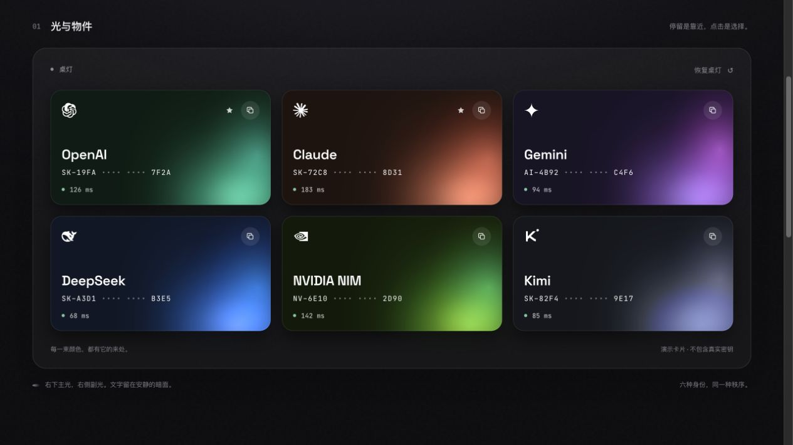

# Keyfolio Design

Keyfolio 设计语言的可交互 Web 展示页与可复用 Codex Skill：用统一受光的桌面、双色卡片、精确排印和克制动效组织界面。

**[在线体验 →](https://yourkaikai.github.io/keyfolio-design/)**



## 可以体验什么

- 统一桌面光场与 OKLab 双色卡片，悬停、选择时联动环境光。
- 明暗主题，以及 Space Grotesk、PingFang SC、JetBrains Mono 的排印分工。
- 可操作的卡片详情、输入框、按钮、状态切换与色值复制。
- 可关闭的微光动效，并响应系统 Reduce Motion 偏好。

网页是设计语言的 Web 迁移，光形采用近似实现，并非 SwiftUI 像素级复刻。所有卡片数据均为演示；本项目不是密钥管理服务。

## 本地运行

展示页采用 HTML、CSS 和原生 ES modules，无需安装 npm 依赖。运行命令需要 Node.js/npm 与 Python 3。

```sh
npm run check
npm run preview
```

打开 <http://127.0.0.1:4832>。`check` 仅检查 JavaScript 语法，`preview` 通过 Python 静态服务预览 `docs/`。

## 使用 Skill

在仓库根目录执行：

```sh
mkdir -p ~/.codex/skills
cp -R skills/keyfolio-design ~/.codex/skills/
```

随后在 Codex 中用 `$keyfolio-design` 调用，例如：

> 用 $keyfolio-design 把这套设计语言迁移到我的项目，保留统一桌面、物件受光与排印层级。

具体规则见 [SKILL.md](skills/keyfolio-design/SKILL.md)，配套参考涵盖基础、组件和光效动效。

## 项目结构

- [docs/](docs/)：可直接部署的展示页与静态资源。
- [skills/keyfolio-design/](skills/keyfolio-design/)：Skill 与设计参考。
- [preview/showcase.png](preview/showcase.png)：预览截图。
- [THIRD_PARTY_NOTICES.md](THIRD_PARTY_NOTICES.md)：字体许可与品牌标识说明。
